    # Loja de Jogos – Lucas_Oliveira

Sistema web completo de uma **loja de jogos digitais**, desenvolvido em **PHP 8, MySQL, PDO, POO e arquitetura MVC** como trabalho da disciplina de **Linguagens de Programação**.

## Integrantes

| Nome | Função |
|---|---|
| Lucas Oliveira | Desenvolvimento, banco de dados e documentação |

## Tema da loja

Loja de **jogos** : catálogo com capas, categorias, carrinho, pagamento (cartão, Pix ou boleto), lista de desejos, biblioteca de jogos comprados e uma área administrativa completa.

## Descrição do sistema

- **Cliente (público):** vê a página inicial e o catálogo com busca e filtros, abre a página de detalhes do jogo, cria conta (nome, e-mail, telefone e senha), faz login, monta o carrinho, compra, acompanha seus pedidos e mantém uma lista de desejos.
- **Administrador:** acessa o painel restrito por login e gerencia jogos, categorias, clientes, usuários e pedidos (CRUD completo), além de consultar o dashboard e o relatório de vendas.

### Regras de negócio

1. Só usuários autenticados podem comprar; só administradores acessam `/admin`.
2. Todo usuário do tipo **cliente** possui um registro em `clientes` (telefone, CPF e nascimento opcionais).
3. O e-mail é único. A senha é guardada com `password_hash()` e conferida com `password_verify()`.
4. Ao criar um pedido o **estoque é baixado**; ao cancelar ou excluir um pedido ativo, o estoque **volta**; ao editar a quantidade, o estoque é ajustado pela diferença (tudo em transação).
5. Pedido pago com cartão nasce como **pago**; Pix e boleto nascem **pendentes** até o admin confirmar o pagamento.
6. Não é possível comprar mais unidades do que o estoque; jogos com estoque 0 aparecem como esgotados.
7. Um cliente (ou usuário) que já fez pedidos **não pode ser excluído**, para preservar o histórico de vendas.
8. Excluir uma categoria não apaga os jogos: eles ficam “sem categoria”. Excluir um jogo mantém os pedidos antigos (o título fica gravado no pedido).
9. O faturamento do dashboard considera apenas pedidos **pagos**.

## Tecnologias utilizadas

PHP 8 · MySQL/MariaDB · PDO (prepared statements) · Programação Orientada a Objetos · Arquitetura MVC · HTML5 · CSS3 · JavaScript (puro) · XAMPP · Git/GitHub

## Arquitetura (MVC)

```
Lucas_Oliveira/
├── index.php, catalogo.php            páginas públicas (vitrine)
├── login.php, registro.php, logout.php, recuperar.php, redefinir.php
├── cliente/                           área do cliente logado (carrinho, compra, pedidos, conta...)
├── admin/
│   ├── config/    db.php (classe Database/PDO), auth.php (sessão, login, CSRF), pix.php, biblioteca.php
│   ├── models/    games.php, categorias.php, clientes.php, usuarios.php, pedidos.php, relatorios.php
│   ├── views/     telas do painel (listar / cadastrar / editar de cada entidade, dashboard, relatório)
│   ├── controllers/ ações de exclusão e de pedido (deletar_*, confirmar_pedido, cancelar_pedido)
│   └── public/    css/, js/validacao.js, imagens/ (capas e uploads)
├── sql/           script.sql (banco completo), e atualizar_banco_existente.sql
└── docs/prints/   capturas de tela usadas neste README
```

- **Models** concentram o acesso ao banco (PDO) e as regras de negócio (validação, transações, estoque).
- **Views** exibem os dados e os formulários; **Controllers** recebem as ações (exclusões, confirmar/cancelar pedido), validam o token CSRF, chamam o Model e redirecionam.
- Observação: as páginas da vitrine (`index.php`, `catalogo.php`, `cliente/*`) e os formulários de cadastro/edição do painel processam o próprio `POST` e ainda fazem algumas consultas de leitura direto na própria página; a lógica de gravação e as regras ficam nos Models.

## Diagrama de classes

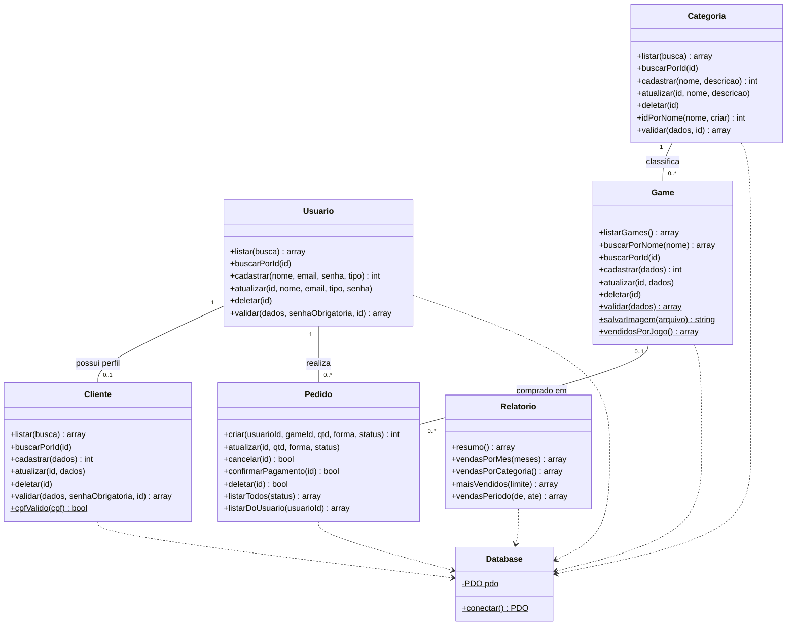

## Modelo do banco de dados

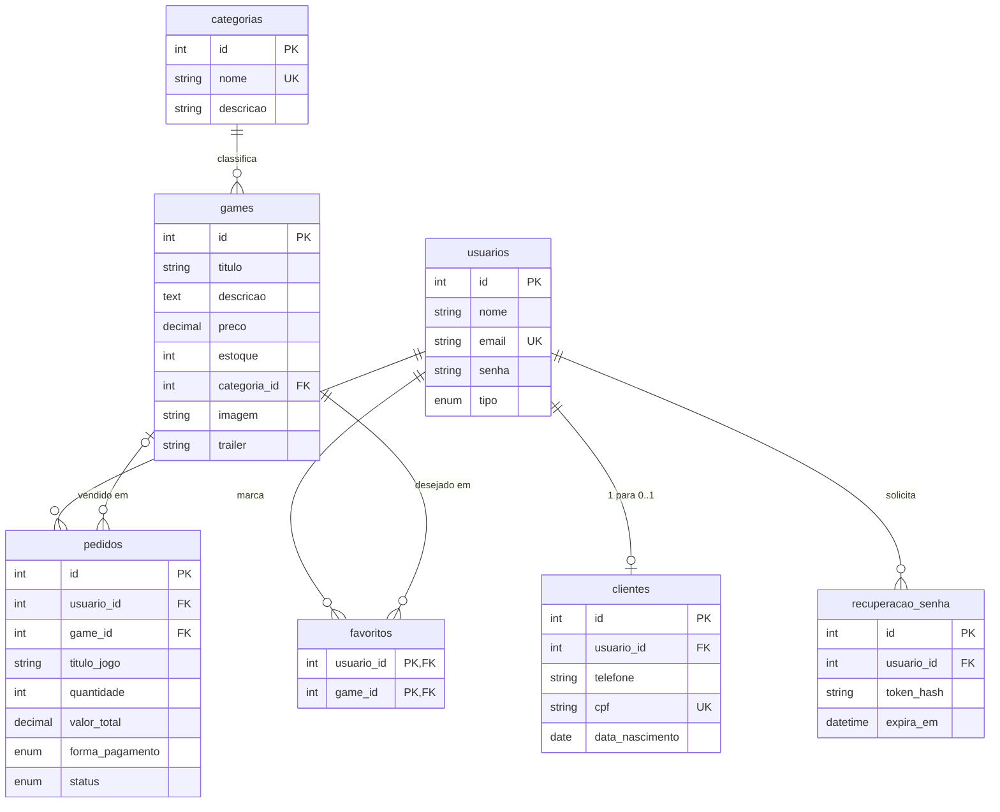

O script completo (criação do banco, tabelas, chaves primárias e estrangeiras e dados de teste) está em [`sql/script.sql`](sql/script.sql).

## Instruções para instalar e executar

1. Instale o **XAMPP** (PHP 8 ou superior) e inicie **Apache** e **MySQL** no painel de controle.
2. Copie a pasta do projeto para `C:\xampp\htdocs\` com o nome **`lucas_oliveira`** (o caminho `/lucas_oliveira` está na constante `BASE` de `admin/config/auth.php`; se usar outro nome de pasta, altere essa constante).
3. Abra o **phpMyAdmin** (`http://localhost/phpmyadmin`), vá na aba **Importar**, escolha `sql/script.sql` e clique em **Executar**. Isso cria o banco `lucas_oliveira`, as tabelas e os dados de teste.
   - Se você já tem um banco com dados e quer mantê-los, importe `sql/atualizar_banco_existente.sql` (faça backup antes).
   - Se importou uma versão anterior do `script.sql`, rode apenas: `ALTER TABLE games ADD COLUMN trailer VARCHAR(255) NULL AFTER imagem;`
4. Se o seu MySQL tiver senha para o `root`, ajuste `admin/config/db.php`.
5. Acesse **http://localhost/lucas_oliveira/**.

### Configurar o assistente de IA (opcional)

1. Crie uma chave gratuita no **Google AI Studio** (`aistudio.google.com` → *Get API key*).
2. Abra `admin/config/ia.php` e cole a chave em `GEMINI_API_KEY`. Esse arquivo está no `.gitignore`: **nunca envie a chave ao GitHub** (o modelo sem chave é `admin/config/ia.exemplo.php`).
3. Se o chat mostrar erro de certificado SSL no XAMPP/Windows, baixe `https://curl.se/ca/cacert.pem`, salve em `C:\xampp\php\extras\ssl\cacert.pem`, aponte `curl.cainfo` para esse arquivo no `php.ini` e reinicie o Apache.
4. Entre na loja, clique em **Assistente** (canto inferior direito) e faça uma pergunta.

A chave fica só no servidor; a IA recebe apenas o catálogo e a pergunta (nenhum dado pessoal), e só jogos existentes no catálogo são aceitos na resposta. Há limite de 15 perguntas a cada 10 minutos por usuário.

## Usuário e senha de teste

| Perfil | E-mail | Senha |
|---|---|---|
| Administrador | `adm@gmail.com` | `123456` |


## Funcionalidades implementadas

**Requisitos obrigatórios**

- Página inicial pública com apresentação da loja e jogos vindos do banco.
- Registro de cliente pela própria interface (nome, e-mail, telefone e senha).
- Login, logout, controle de sessão e proteção da área administrativa (`exigirAdmin()` / `exigirLogin()`).
- Senhas com `password_hash()`.
- **5 classes com CRUD completo** (Model + telas do painel):

| Classe | Listar | Cadastrar | Editar | Excluir |
|---|---|---|---|---|
| Usuario | `ver_usuarios.php` | `cadastrar_usuario.php` | `editar_usuario.php` | `controllers/deletar_usuario.php` |
| Cliente | `ver_clientes.php` | `cadastrar_cliente.php` | `editar_cliente.php` | `controllers/deletar_cliente.php` |
| Game (produto) | `ver_games.php` / `gerenciar_games.php` | `cadastrar_game.php` | `editar_game.php` | `controllers/deletar_game.php` |
| Categoria | `ver_categorias.php` | `cadastrar_categoria.php` | `editar_categoria.php` | `controllers/deletar_categoria.php` |
| Pedido | `pedidos.php` | `cadastrar_pedido.php` | `editar_pedido.php` | `controllers/deletar_pedido.php` |

(Todas as telas do painel ficam em `admin/views/`.)

**Funcionalidades extras (mais de 3)**

- Busca de jogos e filtro por categoria, faixa de preço e ordenação (com busca ao vivo).
- Upload de imagem (JPG, PNG, WEBP ou GIF, até 3 MB, validado pelo conteúdo do arquivo).
- Carrinho de compras e pagamento por cartão, Pix ou boleto.
- Controle de estoque automático (baixa, devolução e ajuste em transação).
- Página de detalhes do jogo com **trailer em reprodução automática** (link do YouTube ou vídeo .mp4/.webm cadastrado no admin, com controle de volume e tela cheia), lista de desejos e biblioteca “Meus jogos”.
- **Dashboard administrativo** (faturamento, vendas, ticket médio, gráfico dos últimos 6 meses, vendas por categoria, mais vendidos, estoque baixo, últimos pedidos).
- **Relatório de vendas** por período, com exportação em CSV.
- **Validação de formulários com JavaScript** (`admin/public/js/validacao.js`): e-mail, telefone com máscara, CPF, preço, quantidade e senha, com mensagens por campo.
- **Assistente de recomendação com IA** (botão de chat nas páginas da loja): o cliente logado descreve o que gosta e o orçamento, e a IA (Google Gemini, plano gratuito) indica até 3 jogos **do próprio catálogo**, com link para a página do jogo. Veja "Configurar o assistente de IA" abaixo.
- Recuperação de senha por link temporário.

**Segurança**

- PDO com *prepared statements* (proteção contra SQL Injection).
- Saída escapada com `htmlspecialchars` (proteção contra XSS).
- Token **CSRF** nos formulários de login, registro e de gravação do painel, e no logout.
- Cookie de sessão `HttpOnly` + `SameSite`, `session_regenerate_id` no login.
- Bloqueio temporário de 60 s após 5 tentativas de login erradas.
- Exclusões somente por `POST` com token CSRF.

## Prints das principais telas

> As imagens abaixo devem ser colocadas em `docs/prints/` com exatamente estes nomes (veja `docs/prints/LEIA-ME.txt`).

| Tela | Print |
|---|---|
| Página inicial | 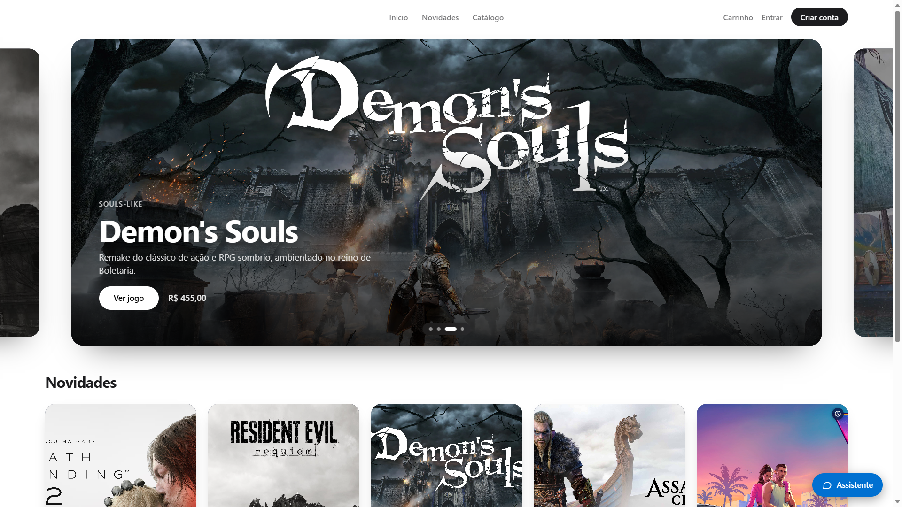 |
| Catálogo com filtros | 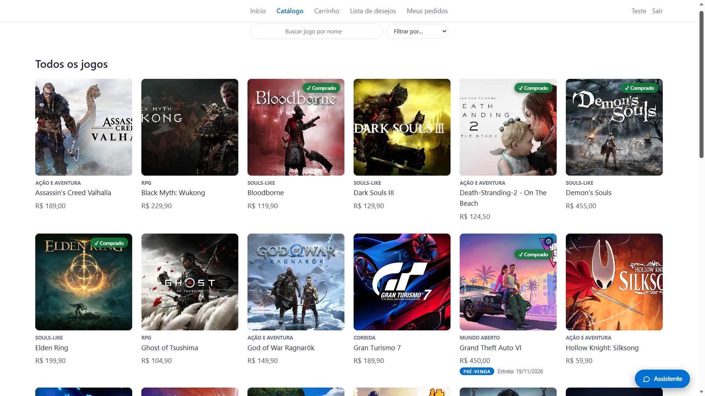 |
| Registro de cliente | 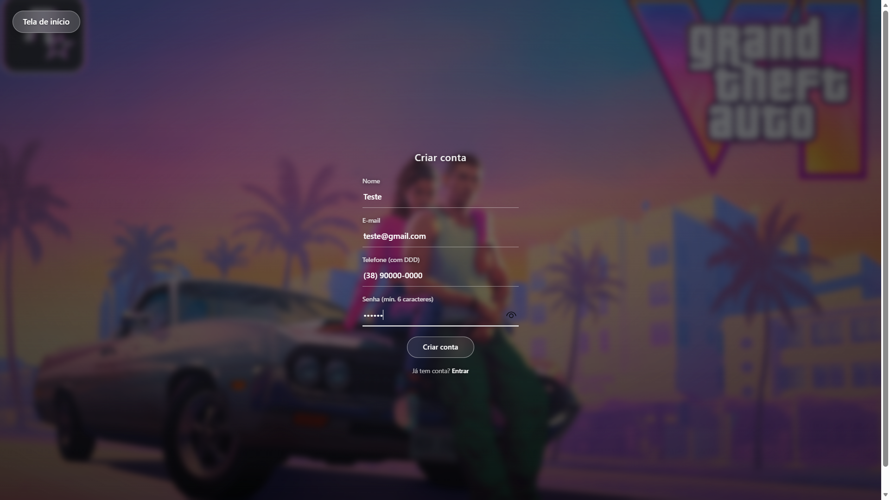 |
| Login | 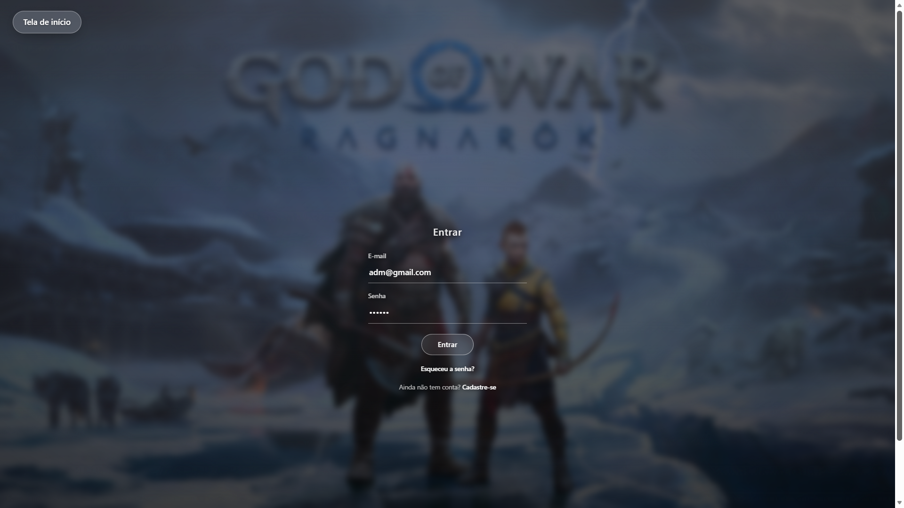 |
| Dashboard | 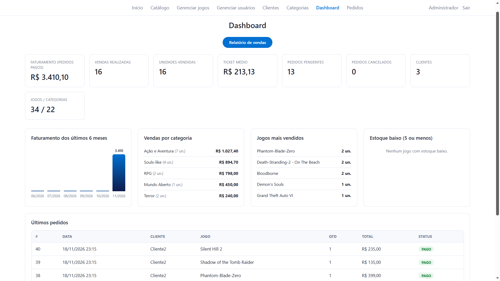 |
| Gerenciar jogos | 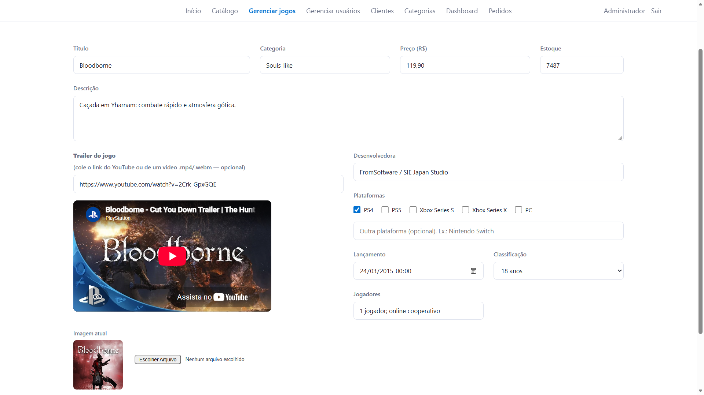 |
| Categorias | 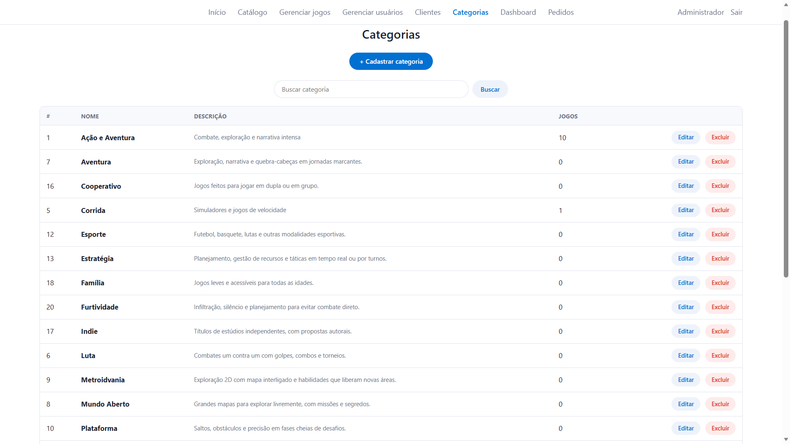 |
| Clientes | 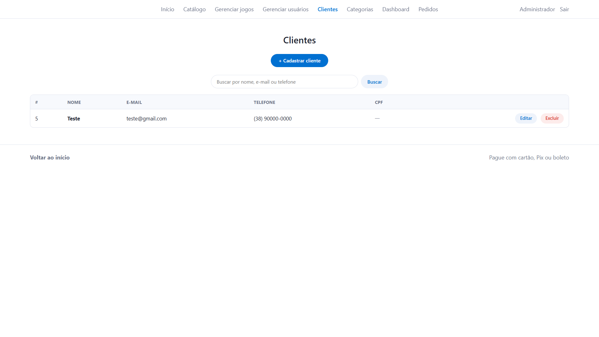 |
| Pedidos | 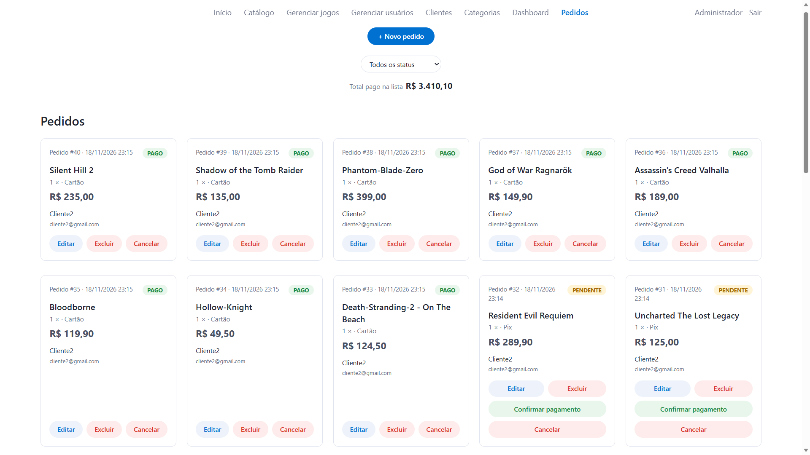 |
| Relatório de vendas | 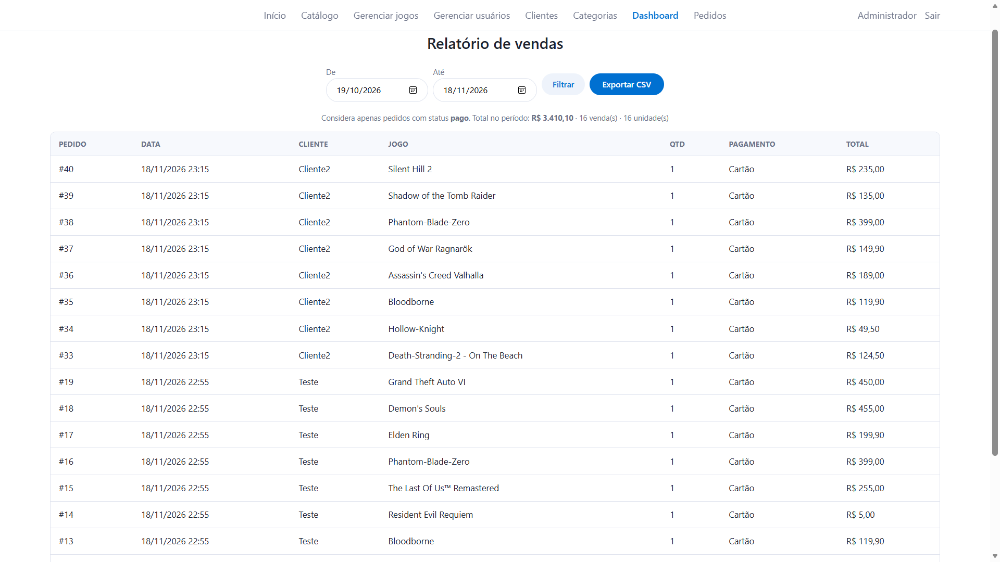 |

## Link do repositório no GitHub

**https://github.com/LucasWinsx/Lucas_Oliveira**


## Ajustes de segurança e ambiente

- **Chave da IA:** `admin/config/ia.php` vem **sem chave**. Crie uma chave nova no Google AI Studio e cole em `GEMINI_API_KEY`. A chave antiga foi exposta e deve ser apagada no AI Studio.
- **cURL opcional:** o assistente usa cURL quando disponível; sem ele, usa as streams do PHP (precisa de `extension=openssl` e `allow_url_fopen=On`).
- **Banco:** por padrão usa `root` sem senha (XAMPP). Para outro usuário, copie `admin/config/db.local.exemplo.php` para `db.local.php`.
- **Fuso horário:** o sistema usa `America/Sao_Paulo` (PHP e sessão do MySQL).
- **Pix:** defina `PIX_CHAVE` em `admin/config/pix.php`. Enquanto estiver com o texto de exemplo, o pagamento por Pix mostra um aviso.
